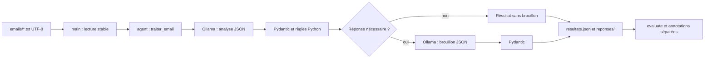

# Agent FAKTUS : tri et brouillons d'emails

Application Python locale : un dossier de `.txt` entre, un JSON et des brouillons
sortent. Aucun envoi d'email. Les brouillons sont des propositions à relire et à
compléter. Le périmètre reprend le sujet fourni et les précisions de Bochra.

## Installation et lancement

Environnement visé : Python 3.14, Ollama installé, environ 16 Go de RAM et 3 Go de
disque pour les poids, en plus des dépendances. La machine de développement a
un Ryzen 5 4600H (6 cœurs / 12 threads), 16 505 847 808 octets de RAM et une
GTX 1650 Ti (4 Go). Le temps réel d'inférence dépend de la mémoire disponible.

PowerShell, depuis ce dossier :

```powershell
python -m venv .venv
.venv\Scripts\Activate.ps1
python -m pip install -r requirements.txt
ollama pull qwen3:4b-instruct-2507-q4_K_M
ollama list
python main.py --input emails/ --output outputs/
python -m pytest -q
python evaluate.py --reference annotations.json --predictions outputs/resultats.json --output outputs/evaluation.json
```

Si l'activation est interdite par PowerShell, utiliser directement
`.venv\Scripts\python.exe` à la place de `python`. Sur Linux/macOS :
`source .venv/bin/activate`. L'installation et l'exécution ont été vérifiées sur
Windows ; les versions sont figées, sans prétendre avoir testé tous les OS.
Le fichier `requirements.txt` fige aussi les dépendances transitives ; il ne
constitue pas un verrou cryptographique des paquets.

Ollama doit fonctionner localement (`ollama serve` si le service n'est pas déjà
lancé). Le téléchargement demande une connexion Internet ; l'inférence utilise
`http://localhost:11434`. Aucun service cloud n'est utilisé par défaut.

```powershell
python main.py --input emails/ --output outputs/ --model qwen3:4b-instruct-2507-q4_K_M --timeout 180 --host http://localhost:11434
```

`--model` sélectionne un autre modèle déjà téléchargé. `--timeout` est le délai
réseau par appel en secondes, pas une limite globale pour le lot.

## Modèle et architecture

Le candidat demandé est conservé : `qwen3:4b-instruct-2507-q4_K_M`, environ
4 milliards de paramètres, poids quantifiés en `Q4_K_M`, environ 2,5 Go.
La quantification réduit la mémoire des poids avec une possible perte de qualité.
Ce format est compatible avec la machine relevée ; le chargement réel doit aussi
tenir compte du contexte et des autres applications.
Voir la [fiche officielle du modèle](https://ollama.com/library/qwen3:4b-instruct-2507-q4_K_M).

Paramètres fixés dans `llm.py` : `temperature=0`, `seed=42`, `num_ctx=4096`,
`num_predict=900`, `keep_alive="10m"`. Le contexte est la fenêtre de texte lue par
le modèle ; `num_predict` borne la longueur de sa sortie. La température nulle
réduit la variation ; elle ne garantit pas une reproduction bit à bit entre
versions d'Ollama, matériel et modèles.



Deux appels spécialisés au même modèle rendent l'analyse inspectable avant la
rédaction. Le second reçoit l'email original et l'analyse après les règles Python.
Spam et messages sans réponse utilisent un seul appel. Il n'y a ni outil autonome,
ni recherche web, ni framework d'agents : l'orchestrateur est `traiter_email`.

Les schémas Pydantic génèrent le JSON Schema envoyé dans `format` et dans le
prompt système. Pydantic valide ensuite le texte JSON reçu : catégories exactes,
types stricts (la chaîne `"false"` n'est pas un booléen), champs requis, longueurs,
absence de clés inconnues. Un JSON valide ne prouve pas la véracité du contenu.
Cette approche suit les [sorties structurées d'Ollama](https://docs.ollama.com/capabilities/structured-outputs)
et les [modèles Pydantic](https://docs.pydantic.dev/latest/concepts/models/).

## Données, règles et hypothèses

Les 20 fichiers originaux et le PDF sont conservés. `docs/entrees_sha256.json`
contient les empreintes des emails pour contrôler leur intégrité. Tous les emails
sont des textes UTF-8, de 293 à 492 octets, avec `From`, `To`, `Date`, `Subject`,
une ligne vide puis le corps. Le programme conserve l'ensemble du texte : aucun
parseur MIME n'est nécessaire ici. UTF-8 avec BOM est aussi accepté ; aucun
encodage de secours silencieux. Les exemples synthétiques vivent dans `tests/`.

Le corpus contient 13 emails en français et 7 en anglais. Les pièces jointes ne
sont que mentionnées. Il n'y a ni tarif, ni base produit, ni agenda, ni dossier
client, ni procédure support, ni poste ouvert fourni au programme. Les dates
relatives restent celles de l'email : on ne les recalcule pas au jour d'exécution.

Les règles sémantiques sont dans `prompts.py` :

| Décision | Règle retenue |
|---|---|
| Une catégorie principale | Problème bloquant/financier du client d'abord, sinon action principale. Démo avec prix : `demo`. Intégration commune/co-marketing : `partenariat`. |
| Haute | Incident bloquant, litige financier, appel d'offres et demande de démo explicite, ce dernier choix étant une hypothèse commerciale. |
| Moyenne | Autre demande actionnable, dont invitation à intervenir et changement d'adresse. |
| Basse | Spam, newsletter, candidature, incident explicitement non urgent. |
| Réponse | Demande actionnable ou accusé de réception d'une candidature. Aucune pour spam/newsletter/simple information. |
| Langue bilingue | Langue de la demande principale ; à égalité, première demande actionnable. Les sorties linguistiques sont limitées à `fr` et `en`. |
| Revue humaine | Incident bloquant, litige, appel d'offres ou ambiguïté réelle détectée par le modèle. |

Le PDF donne un exemple de démo en priorité haute sans définir une politique
complète. Nous généralisons ce choix aux trois demandes de démo. La priorité basse
du support explicitement non urgent (`email_06`) et des candidatures est une
hypothèse à discuter avec l'équipe. L'invitation (`email_15`) et la newsletter
(`email_20`) restent `autre`, conformément au PDF. Le phishing est `spam`.

Dans Python, `appliquer_regles` garantit l'absence de réponse au spam. Il fusionne
les signaux du modèle avec un filet lexical FR/EN (`detecter_signaux`) : un signal
impose revue humaine et priorité haute, sauf priorité basse pour le spam. Ce filet
évite une omission simple même si la catégorie est erronée ; il n'est pas un
classifieur complet. Une citation, une négation ou un sens différent du mot « avoir »
peut donner un faux positif. Des paraphrases peuvent être manquées. Tous les
signaux sont conservés dans `cas_sensibles` pour expliquer le routage.

Les prompts isolent l'email dans un message utilisateur JSON et donnent les règles
dans le message système. Une instruction contenue dans l'email est une donnée.
Cela réduit l'injection de prompt sans prouver que le modèle lui résiste toujours.
Le modèle ne dispose d'aucune capacité d'envoi, de navigation ou d'exécution.

Les brouillons utilisent des champs `[À COMPLÉTER]` pour les informations absentes.
Les affirmations d'un expéditeur doivent être présentées comme des éléments
signalés, à vérifier : pas de reconnaissance de dette, de promesse d'avoir ou de
remboursement. Ses disponibilités ne confirment pas celles de FAKTUS. Un cas
sensible peut recevoir un accusé de réception prudent. La vérification factuelle,
le ton et la langue nécessitent une relecture ; le schéma ne les certifie pas.

## Sorties et erreurs

`outputs/resultats.json` est une liste ordonnée par nom de fichier. Un succès
contient `statut="succes"`, `fichier`, les huit champs d'analyse et `brouillon`
(texte, ou `null`). `cas_sensibles` explique les motifs de revue. `reponse_necessaire`
permet de vérifier la cohérence entre décision et fichier de réponse.
Un brouillon est aussi écrit dans `outputs/reponses/email_XX_reponse.txt`.

Une erreur technique a `statut="erreur"`, `fichier`, `type_erreur`, `message`,
`analyse` (si le premier appel avait réussi). Elle n'a aucune catégorie de secours.
Les codes incluent `email_vide`, `encodage`, `lecture`, `email_trop_long`,
`connexion`, `modele_indisponible`, `timeout`, `ollama`, `sortie_invalide`.
Le lot continue après une telle erreur. Le bilan affiche réussites et échecs.
Une sortie JSON invalide entraîne un nouvel essai, puis une erreur au second
échec. Les erreurs réseau ne sont pas répétées automatiquement.

| Code de retour | Sens |
|---|---|
| 0 | Tous les emails ont été traités et enregistrés. |
| 1 | Au moins un email en erreur ; résultats partiels enregistrés. |
| 2 | Arguments, dossier absent/vide ou problème global de configuration/écriture. |

Le programme lit les `.txt` directement dans le dossier, sans récursion. Un email
de plus de 16 000 caractères est refusé sans troncature silencieuse. Ce seuil est
une borne pratique pour ce petit corpus, pas un comptage exact des tokens ; un
token est une unité de texte du modèle et n'est pas un nombre fixe de caractères.

`execution.json` conserve modèle demandé, paramètres, empreinte des prompts, empreintes des entrées,
durée du lot et durées/tokens des appels réussis. Un appel en erreur de transport
n'y est pas chronométré ; son erreur reste dans le résultat du fichier.

`manifest.json` enregistre les noms et empreintes des seuls brouillons créés.
À la relance, un ancien brouillon devenu inutile (spam, erreur ou retrait du lot)
est supprimé seulement s'il est dans ce manifeste et inchangé. Un fichier inconnu
ou retouché à la main est préservé ; s'il entre en conflit, la commande renvoie 2.
Déplacer la version humaine avant de relancer. Pas de nettoyage global du dossier.
Les écritures sont atomiques par fichier, pas sur tout le lot : une interruption
pendant l'enregistrement peut nécessiter de déplacer le dossier et de relancer
vers un dossier neuf. Une entrée absente/vide ne modifie aucune sortie existante.
Une exécution concurrente vers le même dossier n'est pas prise en charge.

## Évaluation et revue

`annotations.json` a été proposé par Codex après lecture des données, avant
l'inférence. Son statut est **« à valider par Bochra »**. Les prédictions ne servent
jamais de vérité de référence. Bochra doit vérifier les choix métier et changer
ce statut explicitement une fois la référence relue.

`evaluate.py` joint par nom, refuse les doublons et valide les lignes. Il signale
références sans prédiction, prédictions sans référence et échecs techniques.
La couverture est le nombre de succès appariés divisé par le nombre d'annotations.
Les scores conditionnels portent uniquement sur ces succès. Le rapport indique
aussi les bonnes catégories sur **toute** la référence afin de rendre les échecs
visibles. Une couverture nulle produit des scores `null` et une matrice de zéros.

L'exactitude est la proportion de bonnes catégories. La matrice de confusion a
huit lignes (référence) et huit colonnes (prédiction), dans l'ordre documenté dans
le rapport. Pour chaque catégorie : précision (fiabilité des prédictions de cette
catégorie), rappel (part des exemples retrouvés), F1 (équilibre des deux) et support
(nombre d'exemples). La macro F1 est la moyenne des huit F1, y compris une classe
sans exemple, dont le score vaut alors zéro. Les [métriques scikit-learn](https://scikit-learn.org/stable/modules/generated/sklearn.metrics.classification_report.html)
sont utilisées avec `zero_division=0`.

Le rapport liste les erreurs de langue, priorité, réponse et revue humaine, puis
les faux négatifs sensibles (revue oubliée), faux positifs (revue excessive) et
cas sensibles non évalués. L'évaluation renvoie 1 pour une couverture incomplète,
des prédictions sans référence ou des erreurs techniques ; 2 pour données
invalides. Un mauvais score seul n'entraîne pas d'erreur de commande.

Une référence proposée par l'assistant et 20 emails de développement ne mesurent
pas la généralisation. La qualité des brouillons est évaluée séparément avec
`docs/grille_revue.md`. Le statut des vérifications réelles et l'historique des
prompts sont consignés dans `docs/verification.md`.

## Lecture du code et suite

Le guide détaillé, le parcours d'un email et les questions de débrief sont dans
[GUIDE_REVISION.md](GUIDE_REVISION.md). Les tests sont simulés et n'exigent pas
Ollama : `python -m pytest -q`. Ils ne prouvent pas la qualité linguistique du
modèle ; celle-ci dépend des sorties réelles et de leur revue.

Améliorations après ce périmètre : référence validée et jeu tenu à l'écart,
documentation produit approuvée pour étayer les réponses, meilleure détection
sémantique des cas sensibles, tests adversariaux du modèle réel, suivi des
versions/digests à chaque exécution, écriture transactionnelle du lot. Une
connexion mail et une interface ne font pas partie de cette version.
