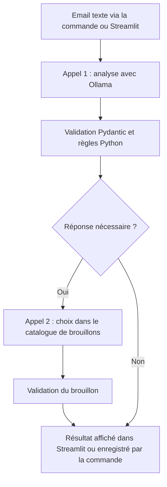

# FAKTUS — Agent de tri et de réponse aux emails

Ce projet analyse des emails et prépare des réponses à relire. Pour chaque email,
il fournit une catégorie, une priorité, un résumé, une justification et, si une
réponse est nécessaire, un brouillon en français ou en anglais.

Le traitement utilise un modèle installé sur la machine avec **Ollama**.
**Aucun email n’est envoyé automatiquement.**

## 1. Installer le projet sur sa machine

### Prérequis

- Installer [Python](https://www.python.org/downloads/) **3.14**, version utilisée pour les essais.
- Installer [Ollama](https://ollama.com/download).
- Récupérer le projet, puis ouvrir un terminal dans le dossier `email-classifier`.
- Prévoir une connexion Internet pour installer les dépendances et télécharger
  le modèle. Ensuite, le traitement fonctionne localement avec la configuration par défaut.

La machine d’essai dispose d’environ **16 Go de RAM**. Le modèle téléchargé occupe
environ **2,5 Go** ; prévoir aussi de la place pour Python et les dépendances.
Les essais ont fonctionné sur CPU : un GPU n’est pas indispensable.

### Windows — PowerShell

Vérifier que `python --version` indique bien Python 3.14, puis exécuter :

```powershell
python --version
python -m venv .venv
.\.venv\Scripts\python.exe -m pip install -r requirements.txt
ollama pull qwen3:4b-instruct-2507-q4_K_M
ollama list
```

Ces commandes créent un environnement Python propre au projet, installent ses
dépendances et téléchargent le modèle. **Il n’est pas nécessaire d’activer
l’environnement** : les commandes utilisent directement son exécutable Python.

### Linux / macOS

Avec Python 3.14 installé :

```bash
python3.14 -m venv .venv
./.venv/bin/python -m pip install -r requirements.txt
ollama pull qwen3:4b-instruct-2507-q4_K_M
ollama list
```

Les essais du projet ont été réalisés sur Windows. Les commandes Linux/macOS
sont fournies pour l’adaptation, sans validation de l’installation sur ces systèmes.

## 2. Lancer l’application

Ollama doit être en cours d’exécution. Si nécessaire, lancer cette commande dans
un autre terminal et le laisser ouvert :

```text
ollama serve
```

Si Ollama est déjà lancé, cette étape est inutile.

**Windows :**

```powershell
.\.venv\Scripts\python.exe -m streamlit run app.py
```

**Linux / macOS :**

```bash
./.venv/bin/python -m streamlit run app.py
```

Ouvrir l’adresse affichée dans le terminal, normalement
[http://127.0.0.1:8501](http://127.0.0.1:8501). `Ctrl+C` arrête l’application.

Dans l’interface :

1. Choisir **Fichiers locaux** et charger les fichiers `.txt`, par exemple ceux de `emails/`.
2. Cliquer sur **Analyser les emails**.
3. Sélectionner un email pour consulter son texte, son analyse et son brouillon.
4. Relire, corriger et télécharger la réponse.

**Télécharger les corrections avant de quitter** : elles restent dans la session
du navigateur et ne sont pas sauvegardées dans `outputs/`.
La connexion Gmail n’est pas configurée ; utiliser les fichiers locaux.

### Utiliser la ligne de commande

Pour traiter les 20 exemples et enregistrer les résultats dans `tmp/mon_test/` :

```powershell
.\.venv\Scripts\python.exe main.py --input emails --output tmp/mon_test
```

Sur Linux/macOS, remplacer `.\.venv\Scripts\python.exe` par `./.venv/bin/python`.

Le dossier de sortie contient :

| Fichier ou dossier | Contenu |
| --- | --- |
| `resultats.json` | Analyse de chaque email, brouillon éventuel et erreurs. |
| `reponses/` | Brouillons dans des fichiers texte séparés. |
| `execution.json` | Modèle, paramètres et mesures de l’exécution. |
| `manifest.json` | Empreintes des brouillons, pour protéger les retouches lors d’une relance. |

Pour utiliser ses propres emails, remplacer `emails` par le chemin de leur dossier.
Mettre les chemins entre guillemets s’ils contiennent des espaces.
Choisir un nouveau dossier de sortie si l’on veut conserver un essai précédent.

Pour ses propres fichiers, conserver les en-têtes `From:` et `Subject:` et une
ligne vide avant le corps. Exemple de fichier `.txt` en UTF-8 :

```text
From: Alex Martin <alex@example.com>
Subject: Demande de démonstration

Bonjour, je souhaite organiser une démonstration de votre solution.
```

## 3. Hypothèses et règles retenues

Ces choix définissent le périmètre du test ; ils ne sont pas des règles universelles
de gestion des emails. Les huit catégories et la revue des cas sensibles viennent
du sujet FAKTUS. Les règles précises de priorité, d’identité et de concision suivent
les demandes de Bochra ; les choix d’implémentation sont expliqués dans la section 4.

| Hypothèse ou règle | Conséquence dans le projet |
| --- | --- |
| Les entrées sont des emails texte en UTF-8, en français ou en anglais. | Un fichier `.txt` par email ; les sous-dossiers et pièces jointes ne sont pas analysés. Un email de plus de 16 000 caractères est refusé. |
| Une seule catégorie principale est attribuée. | Le modèle croise **l’objet et le corps** ; si les deux se contredisent, la demande explicite du corps est privilégiée. Une ambiguïté doit être signalée pour revue humaine. |
| L’identité doit venir du message. | Le résumé et la justification commencent par le nom complet et l’entreprise lorsqu’ils sont fournis. Sinon, utiliser le nom ou le service connu, sans inventer. Le domaine de l’adresse ne suffit pas à déduire l’entreprise. |
| L’analyse doit être facile à lire. | Résumé et justification : chacun **une phrase française, de 180 caractères maximum**. Le résumé décrit le besoin ; la justification explique la catégorie. |
| La langue de réponse suit la demande principale. | Le brouillon est en français ou en anglais selon la langue détectée. La détection d’un message bilingue reste imparfaite. |
| La priorité suit une règle explicite. | `spam` et `autre` : **basse** ; autres catégories : **haute** seulement avec « urgent » dans l’objet et un sujet précisé, **moyenne** sinon. |
| Certains cas nécessitent une personne. | Incident bloquant, litige de facturation et appel d’offres imposent une revue humaine, indépendamment de la priorité. |
| Aucune documentation produit approuvée n’est fournie. | Les brouillons utilisent des formulations préparées et des champs `[À COMPLÉTER]` pour les informations absentes. Une personne les vérifie avant utilisation. |

Le croisement de l’objet et du corps évite qu’un objet vague ou trompeur décide
seul du classement. Si plusieurs demandes coexistent, le modèle privilégie un
problème bloquant ou financier, puis l’action principale demandée. Une demande
de démo avec une question de prix reste ainsi dans `demo`.

Le nom explicite et les phrases brèves facilitent la lecture par l’équipe ;
la limite de 180 caractères est une convention du projet. La priorité est une
règle métier vérifiable, tandis que la revue humaine répond au risque d’une
réponse inappropriée : les deux décisions sont donc indépendantes.

Exemples de priorité : **« URGENT — accès impossible »** peut donner une priorité
haute pour du support ; **« Non urgent — demande de démo »** reste moyenne.
« URGENT » seul ou une urgence mentionnée uniquement dans le corps ne suffit pas.
Un spam reste en priorité basse, même si son objet contient « urgent ».

Les huit catégories possibles sont :

| Catégorie dans le JSON | Signification |
| --- | --- |
| `demo` | Demande de démonstration ou de rendez-vous produit. |
| `question_commerciale` | Question avant achat : prix, intégrations, sécurité, appel d’offres. |
| `support` | Aide à l’utilisation ou problème technique d’un client. |
| `facturation` | Facture, paiement ou demande administrative de facturation. |
| `partenariat` | Proposition de collaboration ou d’apport d’affaires. |
| `candidature` | Candidature à un emploi ou à un stage. |
| `spam` | Publicité non sollicitée ou message frauduleux. |
| `autre` | Invitation, newsletter ou demande hors des catégories précédentes. |

Un spam ne reçoit pas de brouillon. Une newsletter sans demande de réponse non plus.
Une invitation demandant une confirmation peut recevoir un brouillon tout en
restant dans `autre`, avec une priorité basse.

## 4. Comment fonctionne le traitement ?



1. **Lire l’email.** Python extrait l’objet, le corps et le nom affiché de l’expéditeur.
2. **Analyser avec le modèle.** Les consignes de `prompts.py` lui demandent une
   réponse JSON : catégorie, langue, résumé, justification et besoin de réponse.
3. **Contrôler le résultat.** Pydantic, la bibliothèque de validation, vérifie les
   champs attendus, leurs types et les contraintes de texte. Python vérifie et
   met en forme l’identité fournie. Avec un nom affiché connu, il formule la
   justification à partir du motif de la catégorie.
4. **Appliquer les règles.** Python recalcule la priorité et ajoute les alertes
   sensibles détectées par mots-clés, en complément de l’analyse du modèle.
5. **Préparer un brouillon si nécessaire.** Un deuxième appel au même modèle choisit
   une réponse complète parmi les formulations autorisées dans `redaction.py`.
   Tout texte extérieur à cette liste est refusé.
6. **Présenter ou enregistrer le résultat.** L’interface permet la consultation et
   la correction ; la commande écrit les fichiers de sortie.

La classification utilise donc un modèle déjà entraîné, guidé par des consignes :
**aucun entraînement sur les 20 emails n’est réalisé**.
Les règles Python rendent certaines décisions, notamment la priorité, déterministes.

### Pourquoi ce modèle ?

**`qwen3:4b-instruct-2507-q4_K_M`** était le candidat de départ demandé pour ce
projet. Nous l’avons conservé après vérification de son exécution sur la machine
disponible et essais réels sur les emails français et anglais :

- il s’exécute localement avec Ollama, sans clé d’API cloud ;
- sa taille d’environ 4 milliards de paramètres permet de viser la machine disponible ;
- ses poids compressés au format `Q4_K_M` réduisent la mémoire nécessaire ;
- il a été utilisé pour les emails français et anglais du corpus.

C’est un compromis pratique pour ce test. Aucun comparatif complet avec d’autres
modèles n’a été réalisé, et l’effet de la compression sur la qualité n’a pas été
isolé. Les essais sur CPU montrent que ce choix reste lent ; sa présence en local
ne suffit pas à garantir une bonne qualité ni une réponse rapide. Les relevés
sont dans [le diagnostic du modèle](docs/diagnostic_modele.json).

### Pourquoi ces outils et cette organisation ?

| Choix | Pourquoi ce choix et quel compromis ? |
| --- | --- |
| **Python et bibliothèque standard** | Python suit le périmètre demandé. Ses outils intégrés suffisent pour lire les fichiers, interpréter les en-têtes, manipuler le JSON et créer la commande de lancement. |
| **Client Python officiel d’Ollama** | Il fournit les appels au modèle et la gestion du transport ; cela évite de réécrire un client HTTP. Le serveur Ollama doit être installé et lancé séparément. |
| **Fonctions explicites dans quelques modules** | Le parcours comporte des étapes connues. Des fonctions séparant traitement, appels au modèle et interface suffisent pour le suivre et le tester, sans ajouter de framework d’orchestration. |
| **Un LLM pour le sens, des règles Python pour les obligations** | Le modèle interprète les formulations variées. Python impose la priorité et l’absence de réponse au spam. Les alertes par mots-clés complètent le modèle, mais peuvent signaler trop de cas sensibles. |
| **Deux appels spécialisés au même modèle** | Ce découpage suit le périmètre demandé : analyser, valider, puis préparer la réponse. Il permet de sauter la rédaction si elle est inutile et d’identifier l’étape en erreur. Il augmente toutefois la latence. |
| **JSON contraint et validation Pydantic** | Une structure commune facilite l’affichage et l’enregistrement. Le schéma guide le modèle ; Pydantic refuse les champs, types ou textes non conformes. Une structure valide ne prouve pas que le contenu est vrai. |
| **Catalogue de brouillons et champs à compléter** | Les essais de rédaction libre ont inventé des affirmations produit. Le modèle choisit donc un texte autorisé, sans ajouter de faits ; les informations manquantes restent à compléter. Les réponses sont moins personnalisées. |
| **Streamlit et état de session** | L’interface Python réutilise le traitement de la commande et permet de corriger les brouillons. La mémoire de session convient à cette démonstration ; les corrections doivent être téléchargées avant de quitter. |
| **Fichiers locaux, empreintes et écritures protégées** | Ils rendent les résultats faciles à inspecter pour ce petit lot. Les empreintes repèrent les brouillons retouchés et les anciennes analyses. Le remplacement atomique protège chaque fichier pendant l’écriture, sans garantir une transaction sur tout le lot. |
| **Traitement séquentiel et reprises limitées** | Un email à la fois garde le suivi simple et limite les appels simultanés sur la machine CPU. Deux tentatives au maximum corrigent un JSON invalide sans boucle infinie. Une erreur réseau est signalée pour permettre une relance explicite. |
| **pytest et scikit-learn** | pytest vérifie les règles et les erreurs avec un transport simulé ; scikit-learn calcule les métriques usuelles. Les essais réels complètent ces tests : une simulation ne mesure pas la qualité du modèle. |
| **Environnement virtuel et versions figées** | Ils isolent les dépendances et facilitent la reproduction de l’environnement vérifié. Python 3.14 correspond à cet environnement, sans être une nécessité propre au classement des emails ; la compatibilité sur tous les systèmes n’est pas garantie. |

Les consignes demandent aussi de traiter le contenu d’un email comme une donnée,
même s’il contient une demande de changer les règles. Cette séparation réduit
le risque de détourner le traitement ; elle ne garantit pas l’immunité du modèle.

Avec le catalogue actuel, le deuxième appel apporte surtout un choix de thème et
de formulation. Une sélection par règles serait une piste pour réduire la latence
si l’exigence des deux appels était levée. Aucune recherche documentaire n’est
ajoutée en l’absence d’une documentation produit approuvée.

### Pourquoi ces réglages ?

Ils sont définis dans `llm.py`. Un **token** est une unité de texte traitée par
le modèle. Ces valeurs sont des réglages pratiques pour ce test, pas le résultat
d’une recherche de paramètres optimaux.

| Réglage | Justification et limite |
| --- | --- |
| `temperature=0` | Réduire la variation pour une tâche de classement. Cela ne garantit ni l’exactitude ni des résultats toujours identiques. |
| `seed=42` | Fixer une graine pour faciliter les comparaisons. Le nombre 42 n’a pas de propriété particulière ; matériel et versions peuvent encore modifier le résultat. |
| `num_ctx=4096` | Borner la fenêtre de texte et la mémoire utilisée. Les consignes, le schéma, l’email et la réponse doivent se partager cette fenêtre. |
| `num_predict=900` | Laisser de la place au JSON attendu tout en bornant la longueur générée. Une sortie trop longue peut atteindre cette limite et devenir invalide. |
| `keep_alive="10m"` | Garder le modèle chargé entre les emails pour limiter les rechargements, au prix de mémoire occupée pendant cette durée. |
| Délai réseau de `180` secondes | Laisser du temps au traitement local sur CPU tout en bornant l’attente réseau. Ce délai s’applique par appel et se règle avec `--timeout` dans la commande. |
| Deux tentatives de validation | Permettre une correction après un premier JSON refusé, avec un coût et une attente bornés. Une erreur persistante reste visible. |

La limite d’entrée de **16 000 caractères**, dans `agent.py`, écarte les fichiers
anormalement longs pour ce corpus. C’est un garde-fou simple, pas un comptage de
tokens : elle ne garantit pas à elle seule que toute la requête tient dans le contexte.

Les détails des essais ayant motivé ces compromis sont dans
[le bilan de vérification](docs/verification.md).

## 5. Tester et vérifier les résultats

**Tests du code, sans lancer Ollama :**

```powershell
.\.venv\Scripts\python.exe -m pytest -q
```

**Comparer un essai réel aux annotations proposées :**

```powershell
.\.venv\Scripts\python.exe evaluate.py --reference annotations.json --predictions tmp/mon_test/resultats.json --output tmp/mon_test/evaluation.json
```

Cette deuxième commande s’utilise après le traitement en ligne de commande.
Elle mesure notamment les catégories correctes, les erreurs techniques et les
écarts de priorité, de langue et de besoin de réponse. Elle ne relance pas le modèle.

Dernière vérification réelle, le **20 novembre 2026** :
**20 emails traités, 0 erreur technique, 17 brouillons**, en environ **14 min 41 s
sur CPU**. La suite de tests du code compte **149 tests réussis**.
Les résultats livrés sont dans [outputs/](outputs/). Le
[bilan de vérification](docs/verification.md) décrit les essais et leurs limites.

### Limites connues

Les catégories et décisions évaluées correspondent toutes à la référence proposée.
Cette référence reste **à valider par Bochra**, et les 20 emails constituent un
petit corpus de développement. Ce résultat ne garantit ni les performances sur
de nouveaux emails, ni la fidélité de chaque résumé : des formulations imprécises
restent à relire.
Le nom et l’entreprise déclarés dans un email ne sont pas authentifiés par l’application.

Le traitement sur CPU reste lent, la détection des emails bilingues est imparfaite
et le catalogue limite la personnalisation des réponses. Les cas sensibles sont
signalés pour une revue humaine ; tous les champs à compléter doivent être relus.

### Ce que nous améliorerions avec plus de temps

- **Évaluation :** faire valider les annotations et mesurer les résultats sur
  un nouveau lot indépendant des emails de développement.
- **Réponses :** utiliser une documentation produit approuvée pour proposer
  des brouillons plus personnalisés et étayés.
- **Robustesse :** élargir les essais sur les messages bilingues, les demandes
  ambiguës et les instructions malveillantes contenues dans les emails.
- **Rapidité :** comparer plusieurs modèles et configurations matérielles avec
  des mesures répétées de qualité et de latence, avant de choisir une optimisation.

## 6. En cas de problème

| Problème | Action |
| --- | --- |
| Ollama inaccessible | Vérifier qu’Ollama est lancé ; utiliser `ollama serve` si nécessaire. L’adresse par défaut est `http://localhost:11434`. |
| Modèle introuvable | Relancer `ollama pull qwen3:4b-instruct-2507-q4_K_M`, puis vérifier avec `ollama list`. |
| Traitement lent | Sur CPU, un email peut prendre plusieurs dizaines de secondes, davantage avec une reprise. Le traitement est séquentiel. |
| Délai dépassé en ligne de commande | Ajouter `--timeout 300` si la machine a besoin de plus de temps. Le délai par défaut est de 180 secondes **par appel**, pas pour tout le lot. |
| Email marqué « Erreur » | Ouvrir **Détail des erreurs**, puis **Réessayer les erreurs** pour un échec récupérable. Corriger et recharger un fichier vide, trop long ou mal encodé. |
| Résultat marqué « À actualiser » | Les règles ont changé depuis son analyse ; cliquer sur **Analyser les emails** ou **Réanalyser cet email**. |
| Brouillon modifié qui bloque une relance CLI | Conserver sa version corrigée ailleurs ou choisir un nouveau dossier de sortie. La commande protège les retouches manuelles. |

En cas de réponse JSON invalide, le programme demande une correction au modèle,
avec **deux tentatives maximum**. Une erreur est signalée si les deux échouent.
Les erreurs réseau ne sont pas réessayées automatiquement.
Les diagnostics de l’interface sont enregistrés dans `tmp/diagnostics_interface/`.

## 7. Repères dans le projet

Le traitement reste une suite de fonctions Python : lire, analyser, appliquer
les règles, puis préparer la réponse. Les fonctions de validation et d’interface
sont séparées pour pouvoir suivre chaque étape et la tester. Le modèle, ses
consignes et les brouillons autorisés conservent le comportement vérifié.

| Fichier | Rôle |
| --- | --- |
| [app.py](app.py) | Interface Streamlit. |
| [main.py](main.py) | Traitement d’un dossier et enregistrement des sorties. |
| [agent.py](agent.py) | Enchaînement analyse, règles métier et brouillon. |
| [llm.py](llm.py) | Appels à Ollama, paramètres et gestion des erreurs. |
| [prompts.py](prompts.py) | Consignes données au modèle. |
| [schemas.py](schemas.py) | Structure et validation des réponses. |
| [redaction.py](redaction.py) | Catalogue des brouillons autorisés. |
| [evaluate.py](evaluate.py) | Comparaison aux annotations de référence. |
| [diagnostics.py](diagnostics.py) | Enregistrement local des erreurs de l’interface. |

Les dossiers du rendu sont `emails/` pour les entrées, `outputs/` pour les
résultats, `tests/` pour les tests et `docs/` pour le bilan et ses preuves.
`.streamlit/` contient la configuration de l’interface.

Pour approfondir : [vérifications, limites et améliorations envisagées](docs/verification.md).
